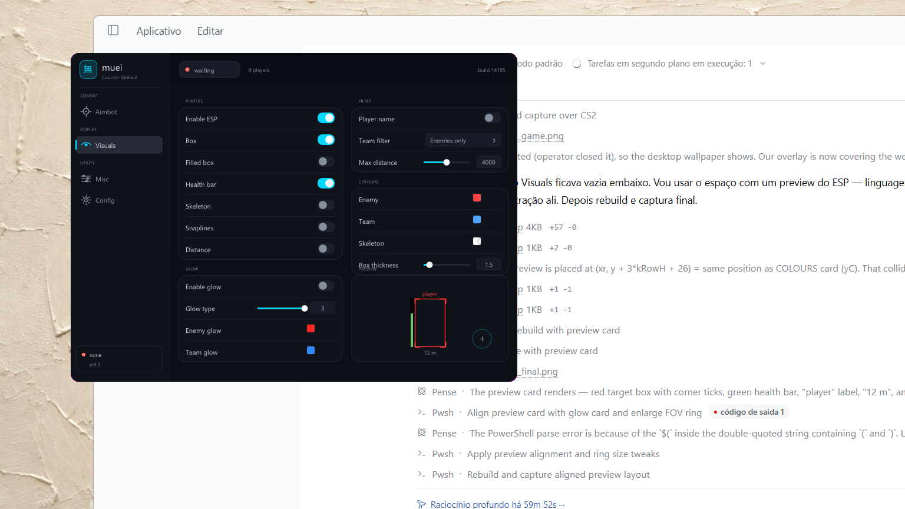
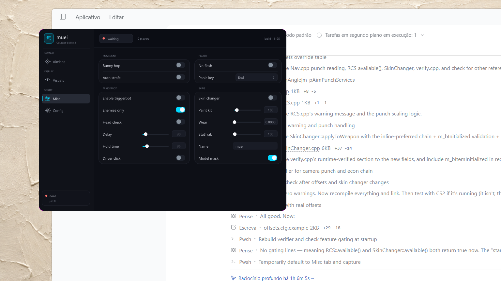

# muei ç„¡å½±

CS2 external overlay. C++20, D3D11 + ImGui, one process, one read handle, one
window on top of the game. Nothing to install, no driver, no second machine.

```
muei/
├── core/        process handle, config, logging
│   ├── IMemory.h        interface every feature reads through
│   ├── ProcUser.*       OpenProcess + ReadProcessMemory
│   ├── Config.*         JSON persistence
│   └── Log.*            single-file log sink
├── sdk/
│   ├── Offsets.h/.cpp   offset table + offsets.cfg override loader
│   ├── Math.h           vectors, angles, w2s, matrix repair
│   ├── Entity.h         Player snapshot, skeleton pairs
│   ├── Nav.h/.cpp       entity list traversal, bone chain, names
│   └── Frame.h          one snapshot per rendered frame
├── features/    Input, Resolver, Aimbot, Triggerbot, Bhop, Glow, RCS,
│                SkinChanger, Misc, ESP
├── ui/          Theme, Overlay (D3D11), Menu (sidebar)
├── imgui/       vendored 1.91.9b + win32/dx11 backends
├── vendor/      nlohmann/json 3.11.3
├── main.cpp     orchestration only
├── build.bat    MSVC -> muei.exe with embedded manifest
├── build_mingw.bat
└── app.manifest requireAdministrator
```

## Releases

Prebuilt packages are attached to tags on GitHub:

| tag | contents |
|---|---|
| `v2026.11.21-single-external` | current — single external build, current offsets |
| `v2026.11.07-1636` | older, still had the driver/DMA backends |

Download the zip, unblock it (Properties ? Unblock) before extracting if Windows
complains about an unsigned binary, then run `run.bat` as administrator.
## Build

```
build.bat
```

Produces `muei.exe` with `app.manifest` embedded (`requireAdministrator`). CS2
runs at High integrity — without the manifest every `PROCESS_VM_READ` is denied
and the log reads `OpenProcess(VM_READ) denied (error 5)`.

`build_mingw.bat` builds the same sources with MinGW-w64. That path has no
manifest embed, so run it from an elevated shell.

## Elevation

CS2 runs at High integrity; a Medium-integrity overlay gets `ERROR_ACCESS_DENIED`
on every `PROCESS_VM_READ`, which looks like "the menu works but shows no
players".

Two defences:

- `app.manifest` requests `requireAdministrator`, so the **MSVC** build always
  starts elevated.
- The binary also checks its own token at startup. If it is not elevated it
  re-launches itself through the shell `runas` verb and exits, so a plain
  double-click on the MinGW build still ends up elevated after one UAC prompt.
  `--no-elevate` skips that check, for shells that are already elevated.
- If elevation is declined the overlay still runs, the menu pill reads
  `admin required` instead of a neutral `waiting`, and the log says why.

## Run

1. Start CS2 in **Fullscreen Windowed**.
2. Run `muei.exe` as administrator (the manifest makes this automatic).
3. `INSERT` opens the menu, `END` quits.

First run writes `muei.cfg` (settings) and `muei_log.txt` (diagnostics) beside
the exe. Both are rewritten every run.

If the exe directory is not writable (read-only install, protected folder, run
straight from a zip), the logger falls back to `%TEMP%` and then the working
directory, and reports the first failure through `logx::initError()`. It does
not lose the diagnostics exactly when they matter.

While no game is attached the attach retry backs off — 2 s, 4 s, 8 s, capped at
30 s — so an idle overlay costs nothing and does not fill the log with the same
four lines.

## How it reads the game

One handle: `OpenProcess(PROCESS_VM_READ | PROCESS_QUERY_LIMITED_INFORMATION)` on
`cs2.exe`, then `ReadProcessMemory` for every field. A second handle with
`VM_WRITE` is opened lazily, and only when a feature that writes is switched on
(glow, skins, no-flash, angle-write aim).

That is the entire mechanism. No driver, no MemProcFS, no FPGA, no service, no
scheduled task. It needs administrator rights because CS2 runs at High integrity
and a Medium-integrity process cannot read it at all — that is a Windows rule,
not a design choice here.

## Offsets

`client.dll` RVAs and schema fields live in one mutable table, `g_off`.

Every field can be overridden at runtime — copy `offsets.cfg.example` to
`offsets.cfg` beside the exe and edit. Decimal or `0x` prefixed strings both
parse. A partial file overrides only what it names, so a game update is a text
edit, not a rebuild.

### Where the numbers come from

One cs2-dumper snapshot, used as a set: the module RVAs and the schema field
offsets come from the same pass. That matters — an old RVA set paired with a new
schema, or the reverse, reads the wrong memory while looking entirely plausible.

The table is trimmed to the 51 fields the code actually reads. A field nobody
reads is a field nobody maintains.

**After a game update**, run `muei.exe --verify`. If it reports FAIL, refresh
`offsets.cfg` from a fresh dump of the same build rather than patching single
values.

### The features that used to be gated

Recoil control, the resolver lead and the skin changer all needed offsets this
project did not have. They are now populated:

| Feature | Chain |
|---|---|
| Recoil | `pawn + m_pCameraServices → + m_vecCsViewPunchAngle` |
| Resolver | `pawn + m_vecAbsVelocity` |
| Skin changer | `pawn + m_pWeaponServices → m_hMyWeapons[] → weapon + m_pAttributeManager → + m_Item → m_iItemDefinitionIndex` |

The gates stay in the code. If a future update moves one of these, the field goes
back to 0 in `offsets.cfg`, the feature disables itself and says which field it
is missing — it never writes through an unverified offset.

### Self test

```
muei.exe --verify
```

Runs inside the same binary, elevated, with CS2 in a map. Attaches, resolves
every offset, proves each one against live memory and writes `muei_check.txt`
with a PASS / FAIL / SKIP table, then opens it. For the skin chain it reports
whether the item view resolved inline or through a pointer, and whether the item
had been initialised yet. Exit code 0 means everything checked out.

One binary instead of two: fewer unsigned artefacts for Windows application
control to block, and nothing to keep in sync.


## Features

| Feature | Mechanism |
|---|---|
| ESP | box from projected head/foot bones, health bar, skeleton, snaplines, distance |
| Aimbot | angular FOV cone, relative-mouse or angle-write, auto fire |
| Resolver | leads the target by bullet travel time + latency, clamped to the player volume |
| Triggerbot | reads the engine's own crosshair entity handle, optional head check |
| RCS | cancels the view punch delta through sensitivity |
| Bhop | holds jump across the airborne phase, optional strafe assist |
| Glow | per-entity glow property write with full restore on disable/exit |
| SkinChanger | fallback paint kit + item metadata on owned weapon entities |
| Misc | flash suppression |

Render: the overlay inherits the game's `HWND` when one exists (no z-order war,
nothing to flash). Only when no game window is found does it create its own
layered, colour-keyed window, and in that case it uses the bitblt swap model —
the flip model presents through DWM, which ignores `LWA_COLORKEY` and paints the
key colour as an opaque rectangle.

## Interface

The menu is drawn, not composed. There are no ImGui widgets in it except the
custom-name text field and the colour pickers, because those need real input
handling; everything else is `ImDrawList` primitives plus `InvisibleButton` hit
testing.

The shell follows the NeverLose layout:

- 758×558 rounded window, 14 px radius, near-black surface with a soft drop shadow
- 168 px sidebar: brand block (ç„¡ mark + wordmark + game subtitle), captioned nav
  groups (`COMBAT`, `DISPLAY`, `UTILITY`), accent bar on the active row, live
  live state footer
- 56 px toolbar: attach pill with a state dot, player count, build tag
- content grid of rounded cards, each with a caption above it and 37 px rows
  separated by hairline dividers
- three custom controls: pill toggle with a sliding knob, slim slider with a
  value pill, and a popup select

Every animated value runs through `Motion()`, an exponential ease kept in the
window state storage keyed by the widget ID: hover glow, knob travel, slider
fill, page transitions and the select popup all settle rather than snap. Page
changes fade and slide the content vertices.

The reference for the visual language was the community NeverLose shell
(`Fdiue/neverlose-last`) — layout, row rhythm, motion feel and control shapes.
The implementation here is independent: different widget set, different state
model, no icon font (the four nav glyphs are drawn as vector shapes), and popup
selection goes through a slot table so a popup can never hold a pointer into a
dead stack frame.



The Visuals page carries a live preview board: it draws the same box, health bar,
label and FOV ring the ESP would use, in the colours currently selected, so the
palette can be tuned without entering a match.



## Verification

What was actually run, not assumed:

- **All 26 translation units compile** — MSVC script (`build.bat`) and MinGW-w64
  16.2 (`build_mingw.bat`), zero warnings at `-Wall -Wextra`.
- **The whole program links** — `muei.exe`, 4.2 MB, no unresolved symbols.
- **The boot path is proven under a debugger** — breakpoints hit in this order:
  `WinMainCRTStartup` → `__tmainCRTStartup` → `wmain` → `wWinMain` →
  `logx::init` → `CreateFileW` with the correct absolute log path →
  `ImGui::NewFrame` → `ImGui::Render` from `overlay::Instance::end`.
- **Five consecutive frames render** with the custom-drawn menu, verified under
  gdb with the process surviving every one.
- **The menu was captured off the composited desktop** and inspected: shell,
  sidebar, cards, toggles, sliders, selects and colour swatches all render.
- **`verify.exe` builds and runs** — reports and exits non-zero with no game.

Not verified on this machine, because there is no CS2 install here:

- live offset validation (that is what `muei.exe --verify` is for — run it on the game box)
- ESP/aimbot/glow behaviour against a real match

### Two bugs the on-machine run caught

1. **The MinGW build was not self-contained.** It linked `libstdc++-6.dll` and
   `libgcc_s_seh-1.dll` dynamically, so launched from Explorer it died with a
   modal "libstdc++-6.dll was not found" dialog before reaching `wWinMain` — no
   window, no log, process apparently alive. `build_mingw.bat` now links
   `-static -static-libgcc -static-libstdc++` and the exe runs from anywhere.
   (The BuildTools path in `build.bat` was never affected: the MSVC runtime is
   part of Windows.)
2. **The shell was translucent over the colour key.** Any alpha below 255 over
   the magenta key blends to purple instead of being keyed out, which showed as
   a purple panel. The shell body, sidebar, toolbar and popup are now fully
   opaque, and the drop shadow is gone for the same reason.

## Status

Shipping shape: complete tree, compiles clean, links, boots, renders. The
runtime-verified offset block is the one honest gap, and it is gated so a missing
value disables a feature instead of corrupting memory.
